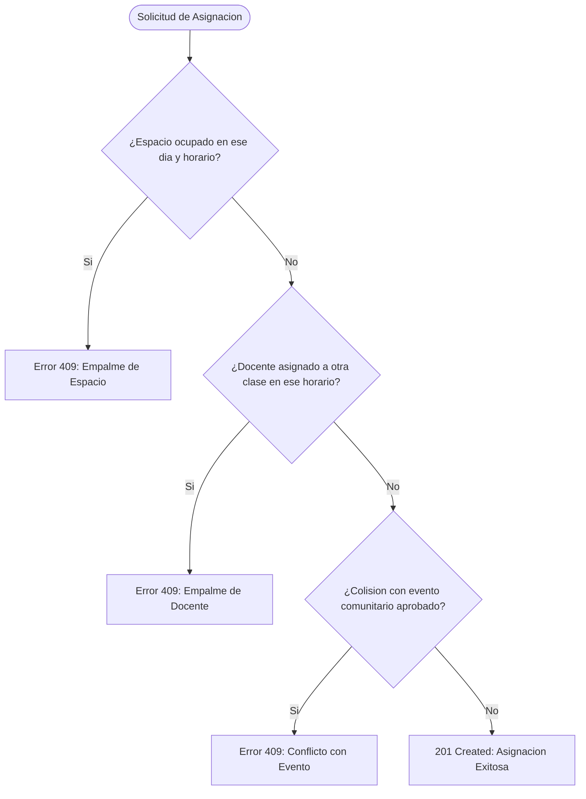

# Manual de Usuario
## Sistema Web de Gestion de Horarios y Recursos Academicos
### Facultad de Informatica — Universidad Autonoma de Queretaro (FIF-UAQ)

---

## 📖 Contenido

1. [Introduccion y Proposito del Sistema](#1-introduccion-y-proposito-del-sistema)
2. [Requisitos Previos y Acceso al Sistema](#2-requisitos-previos-y-acceso-al-sistema)
3. [Perfiles de Usuario y Credenciales de Prueba](#3-perfiles-de-usuario-y-credenciales-de-prueba)
4. [Inicio de Sesion (Modulo de Autenticacion)](#4-inicio-de-sesion-modulo-de-autenticacion)
5. [Manual del Estudiante (Panel de Alumno)](#5-manual-del-estudiante-panel-de-alumno)
   - [5.1 Banner de la Proxima Clase del Dia](#51-banner-de-la-proxima-clase-del-dia)
   - [5.2 Parrilla Semanal Interactiva (Lunes a Sabado)](#52-parrilla-semanal-interactiva-lunes-a-sabado)
   - [5.3 Estados de Clase y Conexion a Videollamadas](#53-estados-de-clase-y-conexion-a-videollamadas)
   - [5.4 Sincronizacion en Tiempo Real](#54-sincronizacion-en-tiempo-real)
   - [5.5 Historial de Solicitudes y Asignaturas](#55-historial-de-solicitudes-y-asignaturas)
6. [Manual del Docente (Panel de Docente)](#6-manual-del-docente-panel-de-docente)
   - [6.1 Resumen General y Metricas](#61-resumen-general-y-metricas)
   - [6.2 Actualizacion de Estado de Clases](#62-actualizacion-de-estado-de-clases)
   - [6.3 Programacion de Sesion Virtual con Enlace](#63-programacion-de-sesion-virtual-con-enlace)
   - [6.4 Emision de Avisos y Observaciones](#64-emision-de-avisos-y-observaciones)
   - [6.5 Mi Horario Docente](#65-mi-horario-docente)
7. [Manual del Administrador (Panel Administrativo)](#7-manual-del-administrador-panel-administrativo)
   - [7.1 Tab Programacion General de Clases](#71-tab-programacion-general-de-clases)
   - [7.2 Sistema de Prevencion de Empalmes (Deteccion de Conflictos)](#72-sistema-de-prevencion-de-empalmes-deteccion-de-conflictos)
   - [7.3 Tab Solicitudes de Eventos y Evaluacion Preventiva](#73-tab-solicitudes-de-eventos-y-evaluacion-preventiva)
   - [7.4 Herramienta "Ver Espacios Disponibles"](#74-herramienta-ver-espacios-disponibles)
   - [7.5 Tab Espacios Academicos y Monitoreo de Ocupacion](#75-tab-espacios-academicos-y-monitoreo-de-ocupacion)
8. [Procedimiento Global: Proponer un Evento Comunitario](#8-procedimiento-global-proponer-un-evento-comunitario)
9. [Preguntas Frecuentes y Resolucion de Problemas](#9-preguntas-frecuentes-y-resolucion-de-problemas)

---

## 1. Introduccion y Proposito del Sistema

El **Sistema Web de Gestion de Horarios y Recursos Academicos** de la **FIF-UAQ** ha sido diseñado para centralizar y optimizar la logistica academica de la facultad, garantizando:

- **Transparencia en tiempo real:** Comunicacion inmediata entre docentes y alumnos ante cualquier cambio en la modalidad de clase (presencial, virtual por videollamada, cancelada o reprogramada).
- **Cero empalmes de recursos:** Mecanismo automatico de validacion que impide el solapamiento de aulas, laboratorios, horarios de profesores o interferencias con eventos aprobados.
- **Participacion comunitaria:** Modulo agil para que estudiantes y docentes soliciten el uso de espacios comunes (auditorios, salas, aulas) con validacion preventiva de disponibilidad.

---

## 2. Requisitos Previos y Acceso al Sistema

Para utilizar el sistema de forma local, asegurese de contar con los servicios activos:

1. **Servidor de Base de Datos (MySQL/MariaDB en XAMPP):** Debe estar iniciado en el puerto estandar `3306`.
2. **Backend (API REST FastAPI):** Ejecutandose en `http://localhost:8000`.
3. **Frontend (Aplicacion React):** Ejecutandose en `http://localhost:5173`.
4. **Navegador Web Compatible:** Google Chrome, Mozilla Firefox, Microsoft Edge, Safari u Opera (versiones actualizadas).

Acceda a la aplicacion abriendo en su navegador:
👉 **`http://localhost:5173`**

> [!TIP]
> En entornos Windows, puedes ejecutar todo con los scripts incluidos:
> - Haz doble clic en **`instalar.bat`** para instalar todas las dependencias.
> - Haz doble clic en **`iniciar_sistema.bat`** para arrancar tanto el Backend como el Frontend automaticamente.

---

## 3. Perfiles de Usuario y Credenciales de Prueba

El sistema implementa control de acceso basado en roles (**RBAC**). Para efectos de prueba academica, se incluyen cuentas preconfiguradas en los datos semilla:

| Perfil / Rol | Expediente | Contraseña | Nombre de Usuario | Proposito Principal |
| :--- | :--- | :--- | :--- | :--- |
| **Alumno** | `2024001` | `prueba123` | Maria Lopez Garcia | Consulta de horarios, acceso a enlaces de videollamadas y solicitud de espacios. |
| **Docente** | `DOC001` | `prueba123` | Juan Perez Hernandez | Notificacion de cambios de clase, enlaces de Meet/Zoom y gestion de alumnos. |
| **Administrador** | `ADM001` | `prueba123` | Laura Ramirez Soto | Programacion horaria general, prevencion de empalmes y aprobacion de eventos. |

> [!NOTE]
> Todos los usuarios registrados en los datos semilla comparten la clave `prueba123`. El sistema no solicita el rol manualmente al iniciar sesion; el rol se detecta automaticamente desde la base de datos para prevenir inconsistencias.

---

## 4. Inicio de Sesion (Modulo de Autenticacion)

Al ingresar a la raiz del sitio (`/`), se desplegara la pantalla oficial de inicio de sesion:


### Pasos para ingresar:
1. Ingrese su **Expediente Universitario** (ejemplo: `2024001`, `DOC001` o `ADM001`).
2. Ingrese su **Contraseña** (por defecto `prueba123`).
3. Haga clic en el boton **Iniciar Sesion**.
4. *(Opcional)* En la parte inferior de la tarjeta encontrara los **botones de acceso rapido** (`🎓 Alumno`, `👨‍🏫 Docente`, `🛡️ Admin`), los cuales rellenan automaticamente los campos para agilizar pruebas.

### Posibles alertas:
- Si el expediente o la contraseña no coinciden con la base de datos, aparecera un **banner rojo** con el mensaje:
  > *"Expediente o contraseña incorrectos"*

---

## 5. Manual del Estudiante (Panel de Alumno)

Ruta en navegador: `/alumno`

Una vez autenticado como alumno, se despliega una interfaz personalizada organizada en tres pestañas y una barra de navegacion superior:

```text
┌────────────────────────────────────────────────────────────────────────┐
│ [FIF] UAQ | Campus Virtual      [+ Proponer evento] [Maria Lopez] [Salir] │
├────────────────────────────────────────────────────────────────────────┤
│ [📅 Mi Horario Semanal]  [📨 Mis Solicitudes]  [📚 Asignaturas]          │
│                                                                        │
│ ┌────────────────────────────────────────────────────────────────────┐ │
│ │ 📌 TU PROXIMA CLASE HOY: BD101 - Bases de Datos                    │ │
│ │ 🕒 08:00 - 10:00 hrs | 📍 Laboratorio 1 | 👨‍🏫 Prof. Juan Perez     │ │
│ │ [📹 Unirse a videollamada]                                         │ │
│ └────────────────────────────────────────────────────────────────────┘ │
│                                                                        │
│  LUNES          MARTES         MIERCOLES      JUEVES         VIERNES   │
│ ┌──────────┐  ┌──────────┐   ┌──────────┐   ┌──────────┐   ┌─────────┐ │
│ │ 08:00    │  │ 10:00    │   │ 08:00    │   │ 12:00    │   │ 08:00   │ │
│ │ BD101    │  │ MAT103   │   │ RED105   │   │ SOP108   │   │ ING106  │ │
│ └──────────┘  └──────────┘   └──────────┘   └──────────┘   └─────────┘ │
└────────────────────────────────────────────────────────────────────────┘
```

### 5.1 Banner de la Proxima Clase del Dia
En la parte superior se calcula y destaca automaticamente su **proxima clase programada**:
- Muestra el codigo de la materia, nombre, horario de inicio y fin, aula y docente.
- Si la clase esta marcada como **Virtual**, aparecera de inmediato un boton destacado: **"📹 Unirse a videollamada"**.

### 5.2 Parrilla Semanal Interactiva (Lunes a Sabado)
Muestra una columna por cada dia lectivo:
- Cada tarjeta contiene:
  - Rango de horario exacto (`08:00 - 10:00`).
  - Clave y nombre de la asignatura.
  - Espacio asignado (ej. *Aula 101*, *Laboratorio de Computo 1*).
  - Docente titular.
  - Insignia de estado.

### 5.3 Estados de Clase y Conexion a Videollamadas
El sistema utiliza codigos de color normalizados para facilitar la rapida identificacion:

- 🟢 **Presencial (Normal):** Borde sutil gris/blanco con insignia verde. La sesion transcurre de forma regular en el aula designada.
- 🔵 **Sesion Virtual:** La tarjeta se resalta en **fondo azul suave con borde azul marino**. Muestra la etiqueta *"Sesion virtual"* y el boton **"📹 Unirse a videollamada"**, el cual abre la liga (Google Meet, Zoom, Teams) en una nueva pestaña del navegador.
- 🔴 **Clase Cancelada:** Tarjeta con fondo e insignia roja. Incluye un recuadro explicativo con la **justificacion dada por el docente** (ej. *"Docente en congreso academico"*).
- 🟠 **Clase Reprogramada:** Tarjeta con fondo e insignia ambar. Incluye las observaciones del docente con la nueva fecha y hora pactada.

### 5.4 Sincronizacion en Tiempo Real
> [!TIP]
> El panel del alumno ejecuta una comprobacion en segundo plano (**polling cada 3 segundos**). Si el docente cambia su clase a virtual o la cancela mientras usted esta en la pagina, la interfaz se actualizara de forma automatica sin requerir recargar el navegador.

### 5.5 Historial de Solicitudes y Asignaturas
- **Pestaña "Mis Solicitudes":** Permite consultar el estado de aprobacion de eventos comunitarios solicitados por usted (`Pendiente`, `Aprobado`, `Rechazado` o `Cancelado`).
- **Pestaña "Asignaturas Inscritas":** Tarjetas consolidadas de todas las materias que forman parte de su carga academica activa.

---

## 6. Manual del Docente (Panel de Docente)

Ruta en navegador: `/docente`

Diseñado para profesores titulares. Permite gestionar de manera agil el estado de cada sesion asignada y notificar avisos a los grupos de alumnos inscritos.

### 6.1 Resumen General y Metricas
Al ingresar, el docente dispone de 3 tarjetas de indicadores globales:
1. **Clases Asignadas:** Total de grupos/materias a su cargo en el periodo.
2. **Estudiantes Inscritos:** Conteo consolidado de alumnos que tienen cargadas sus asignaturas.
3. **Sesiones Virtuales Activas:** Numero de clases configuradas actualmente bajo modalidad remota.

### 6.2 Actualizacion de Estado de Clases
En la pestaña **"Mis Clases Asignadas"**, cada clase cuenta con su propio panel de administracion:

1. Ubique la materia que desea gestionar.
2. En el menu desplegable **"Estado Actual de la Clase"**, elija una de las 4 opciones:
   - `🟢 Presencial (Normal)`
   - `🔵 Sesion Virtual (Videollamada)`
   - `🔴 Clase Cancelada`
   - `🟠 Clase Reprogramada`

### 6.3 Programacion de Sesion Virtual con Enlace
Si selecciona la opcion **Sesion Virtual**:
- El campo de texto **"Enlace a Videollamada"** se activara y resaltara en color azul claro con la etiqueta `* Requerido`.
- Ingrese un enlace web valido que inicie con `https://` o `http://` (ej. `https://meet.google.com/abc-defg-hij`).
- Si intenta guardar sin enlace o con un formato invalido, el sistema no registrara el cambio y mostrara una advertencia en rojo.

### 6.4 Emision de Avisos y Observaciones
- En el campo **"Aviso / Observaciones para los Alumnos"**, escriba notas pertinentes (ej. *"Traer computadora portatil con software instalado"*, *"Falla en el laboratorio 2, nos vemos en linea"*).
- Presione el boton **"Guardar Estado y Notificar"**.
- Al completarse con exito, se desplegara una confirmacion en verde: **`✓ Estado actualizado correctamente`**.

### 6.5 Mi Horario Docente
En la pestaña **"Mi Horario Docente"**, el profesor podra consultar su parrilla semanal de lunes a sabado para verificar la distribucion de sus horas frente a grupo.

---

## 7. Manual del Administrador (Panel Administrativo)

Ruta en navegador: `/admin`

El panel administrativo es la herramienta central para Servicios Escolares y la Coordinacion Academica. Cuenta con tres secciones principales:

---

### 7.1 Tab Programacion General de Clases
Permite gestionar la cuadricula global de clases de la facultad.

#### Asignar una Nueva Clase Programada:
1. Rellene los campos obligatorios del formulario superior:
   - **Materia:** Seleccione del catalogo la asignatura a programar.
   - **Docente Titular:** Seleccione el profesor asignado.
   - **Espacio Academico:** Seleccione el aula, laboratorio o auditorio.
   - **Dia de la Semana:** Lunes, Martes, Miercoles, Jueves, Viernes o Sabado.
   - **Hora Inicio y Hora Fin:** Ingrese el horario (ej. `08:00` a `10:00`).
2. Haga clic en **"+ Asignar y Guardar Clase"**.

---

### 7.2 Sistema de Prevencion de Empalmes (Deteccion de Conflictos)

Antes de registrar cualquier clase, el sistema ejecuta tres algoritmos de validacion en tiempo real:



> [!WARNING]
> Si se presenta cualquiera de los tres casos anteriores, la solicitud sera rechazada con un codigo HTTP **409 Conflict** y se mostrara un banner rojo de advertencia detallando que clase o evento esta provocando el choque.

---

### 7.3 Tab Solicitudes de Eventos y Evaluacion Preventiva
Lista todas las solicitudes de eventos comunitarios registradas por estudiantes y profesores.

- **Evaluacion Preventiva de Conflicto:** Para cada solicitud en estado `Pendiente`, el sistema verifica si existe choque con clases regulares o con otros eventos previamente aprobados.
- Si existe cruce de horario:
  - Se muestra la insignia roja: **`⚠️ Empalme detectado`**.
  - Se detalla la causa exacta (ej. *"Choque con la clase Bases de Datos programada los lunes en Aula 101"*).
  - Se desactiva la aprobacion directa para evitar duplicidad de ocupacion.

---

### 7.4 Herramienta "Ver Espacios Disponibles"
Cuando un evento pendiente presenta un empalme detectado:
1. Presione el boton **"🔍 Ver espacios disponibles"**.
2. Se abrira una ventana emergente que consulta en vivo la disponibilidad de las 12 instalaciones de la FIF.
3. Se listaran unicamente aquellos espacios academicos que se encuentran **100% libres** en esa fecha y rango de horas exactos, mostrando su tipo y capacidad en personas.

---

### 7.5 Tab Espacios Academicos y Monitoreo de Ocupacion
Permite supervisar la carga de los 12 espacios fisicos:
- Cada tarjeta muestra:
  - Nombre del espacio y categoria (*Aula*, *Laboratorio*, *Auditorio*, *Sala de Computo*).
  - Capacidad maxima de alumnos.
  - Conteo de clases programadas en la semana.
  - Horas totales de uso a la semana.
  - **Barra de ocupacion porcentual:**
    - 🟢 **Verde (< 40%):** Ocupacion baja.
    - 🟠 **Ambar (40% - 75%):** Ocupacion media.
    - 🔴 **Rojo (> 75%):** Ocupacion alta / saturacion de horario.

---

## 8. Procedimiento Global: Proponer un Evento Comunitario

Tanto alumnos, docentes como administradores pueden proponer eventos comunitarios (talleres, conferencias, torneos, debates) haciendo clic en el boton azul visible en la barra de navegacion:

👉 **`+ Proponer evento`**

```text
┌────────────────────────────────────────────────────────────┐
│ Proponer Evento Comunitario                            [X] │
├────────────────────────────────────────────────────────────┤
│ Titulo del Evento *                                        │
│ [Taller de Ciberseguridad Defensiva                      ] │
│                                                            │
│ Espacio Academico Requerido *                              │
│ [-- Seleccionar: Auditorio Principal (Cap: 200) --------v] │
│                                                            │
│ Fecha del Evento *                                         │
│ [ 2026-11-20                                            📅]│
│                                                            │
│ Hora de Inicio *                  Hora de Fin *            │
│ [ 10:00                     🕒]   [ 12:00               🕒]│
│                                                            │
│ Descripcion y Objetivo del Evento                          │
│ [Actividad para estudiantes de nuevo ingreso...          ] │
│                                                            │
│ ────────────────────────────────────────────────────────── │
│                       [Cancelar]    [Enviar Solicitud (✓)] │
└────────────────────────────────────────────────────────────┘
```

### Reglas del Formulario:
1. **Validacion en tiempo real:** Si deja algun campo obligatorio vacio o la hora de fin es menor a la de inicio, apareceran advertencias en rojo bajo cada campo.
2. **Bloqueo preventivo:** El boton **"Enviar Solicitud"** permanecera deshabilitado hasta que todos los datos sean validos.
3. **Estado Inicial:** Todas las solicitudes se crean en estado `Pendiente` a la espera de la revision de la administracion escolar.

---

## 9. Preguntas Frecuentes y Resolucion de Problemas

### 1. ¿Por que no puedo conectarme o me aparece error de base de datos?
- Verifique que en el panel de control de **XAMPP** tanto **Apache** como **MySQL** esten encendidos con estado en verde.
- Compruebe que la base de datos `gestion_academica` haya sido importada en [phpMyAdmin](http://localhost:8080/phpmyadmin) (o http://localhost/phpmyadmin) usando el archivo `backend/database/gestion_academica.sql`.

### 2. ¿Como cambio de usuario o de rol para realizar pruebas?
- Haga clic en el boton rojo **"Salir"** en la esquina superior derecha de la barra de navegacion.
- En la pantalla de login, seleccione uno de los botones rapidos: `Alumno (2024001)`, `Docente (DOC001)` o `Admin (ADM001)`.

### 3. ¿Que hago si el docente cambia la clase a virtual pero no veo el boton de videollamada?
- El sistema se sincroniza automaticamente cada 3 segundos. Espere dicho lapso o refresque la pestaña del navegador para obtener los datos mas recientes.
- Verifique que el docente haya ingresado un enlace valido que inicie con `http://` o `https://`.

### 4. ¿Por que el administrador no puede aprobar un evento?
- Si el evento presenta un empalme de horario con clases regulares u otro evento ya aprobado, el sistema impedira su aprobacion para proteger la disponibilidad fisica del espacio. Utilice la opcion **"Ver espacios disponibles"** para reubicar la actividad en un aula desocupada.

---

*Manual elaborado conforme a la Especificacion Tecnica de Implementacion FIF-UAQ.*  
*Facultad de Informatica — Universidad Autonoma de Queretaro, 2026.*
